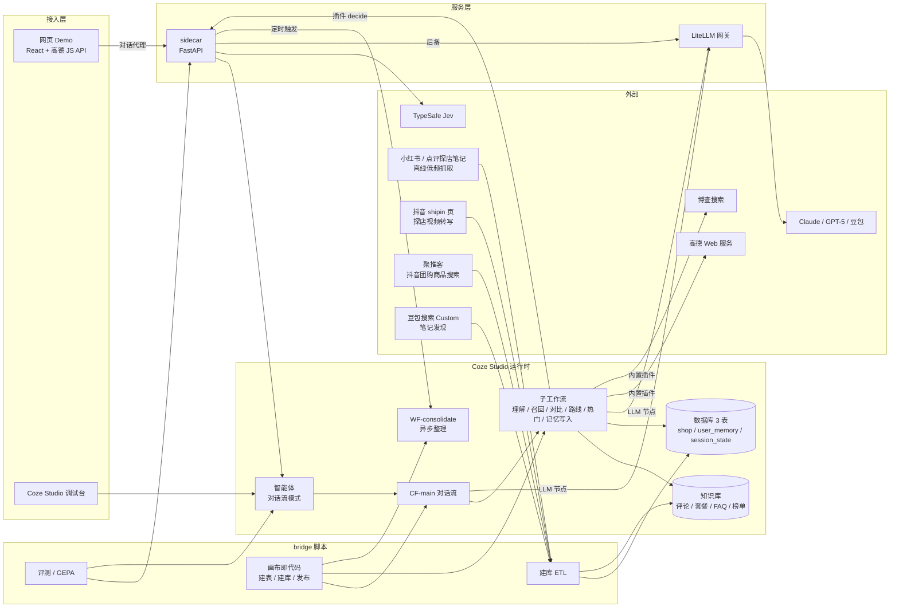
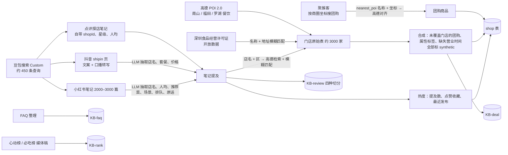
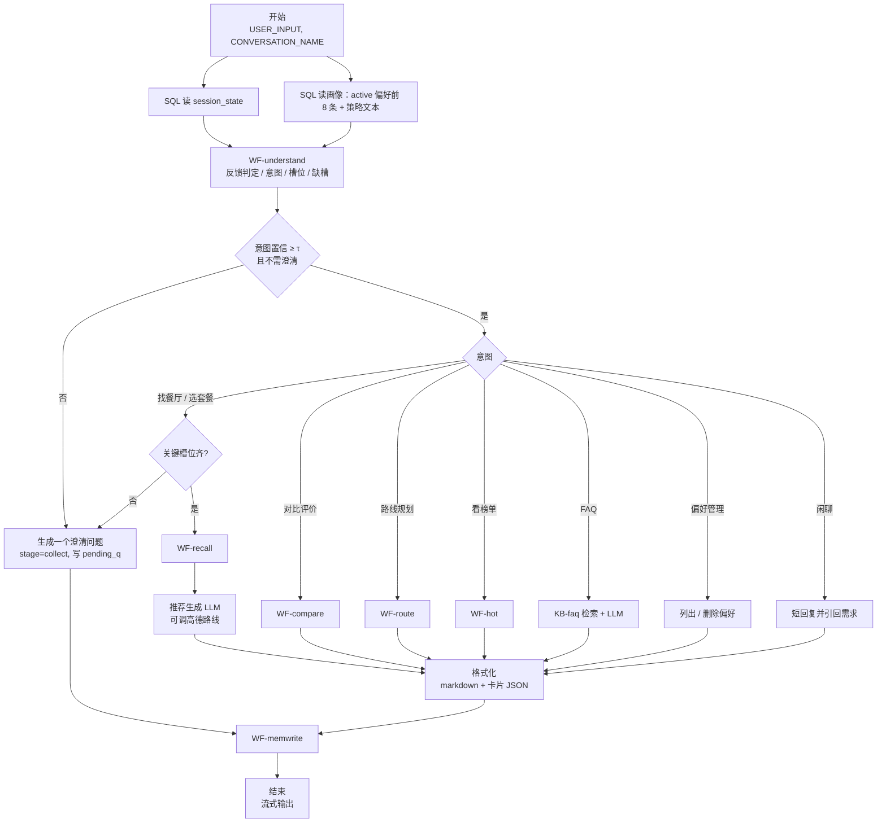
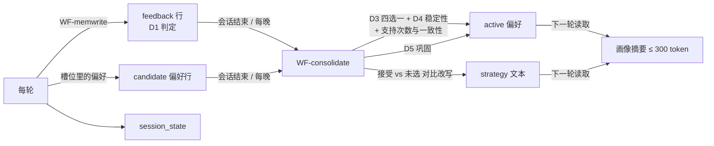

# 抖音本地生活推荐 Agent：设计文档 v0.3

2026-10-19。依据 `research/00_方案草案.md` 和 `research/01–12` 的原始调研。v0.2 把评价、推荐菜、场景、热度改用小红书和点评探店笔记；v0.3 按 research/12 接入抖音侧数据：团购商品来自聚推客商品搜索，抖音探店视频的口播转写来自 `douyin.com/shipin/` 页。本文件定计划、框架、技术栈和编排，PRD 在 M1 单独写。

## 0. 目标、范围、验收

**目标：** 在本机 Coze Studio 上搭一个面向深圳南山、福田、罗湖餐饮的推荐 Agent，覆盖老师任务清单的 12 条和"持续维护用户画像与长短期偏好"。

**做：** 找餐厅、选套餐、对比评价、路线规划、看榜单、FAQ、偏好管理；长短期记忆；每用户策略学习（SAGER）；Jev 决策层；离线评测与 Prompt 优化；网页 Demo。

**不做：** 预订、排队、支付闭环（需要商家接口）；发布到抖音（只剩抖音小程序渠道，要企业主体）；语音输入；拍菜单识图。

**验收：** 每项增强都和基线对照报数。目标值在 M3 基线跑出来后和老师一起定。

| 指标 | 评测集 | 基线 |
|---|---|---|
| 意图准确率、需澄清判定准确率 | E1 | Coze 意图识别节点 |
| 槽位 F1 | E1 | 手写 Prompt |
| 门店召回 recall@5、评论召回 recall@5 与 MRR | E2 | 自动切分、无上下文前缀 |
| 记忆终态正确率 | E3 | 只用会话历史、无长期记忆 |
| 决策准确率、Brier、ECE、选项乱序一致率 | E4 | 普通 LLM 结构化输出 |
| 端到端任务成功率、平均轮数、每轮成本、P50 延迟 | E5 | 关掉记忆和决策层的版本 |
| 个性化命中 HR@1/3/5 | E6 | 不加策略文本 |

## 1. 总体架构



**设计原则：**

1. 主干确定、局部自主。对话流是固定管线，只有推荐生成节点挂工具让模型自己调。依据见 research/07：Cognition 2026-04 的结论是写操作保持单线程，Stanford 2604.02460 固定算力下单 Agent 持平或优于多 Agent。
2. 判断交给决策模型，生成交给 LLM，算术和日期交给代码或 SQL。
3. 每个 LLM 节点的输入是现编的视图（会话状态、画像摘要、本轮候选），不传全量历史。
4. 配置即代码。表、知识库、插件、画布 JSON、Prompt 都由 bridge 脚本生成并发布，能复现，能 diff。
5. 每个增强都有开关和对照：Jev 对 LLM，GEPA 对手写，四种切分，SAGER 开和关。

## 2. 技术栈

| 层 | 选型 | 理由 | 备注 |
|---|---|---|---|
| 运行时 | Coze Studio 开源版，commit fefb05ff，localhost:8888 | 已部署；老师清单里的知识库、工作流、插件、数据库、意图识别都有 | 没有长期记忆和召回测试，自己做 |
| 智能体模式 | 对话流模式（WorkflowMode） | 管线可控，问答节点和流式输出都支持 | 多 Agent 模式只有枚举，没有实现 |
| 关系存储 | Coze 数据库，MySQL 8.4.5 | 门店硬条件过滤 | 每智能体 3 表、每表 20 字段（按官方限额设计，方便以后迁到扣子线上）；SQL 禁 JOIN；`ST_Distance_Sphere` 加 CAST 已在该 MySQL 实测可用 |
| 向量与全文 | Coze 知识库：Milvus + Elasticsearch，嵌入用 text-embedding-3-small 1024 维 | 已配置 | rerank 是 RRF 融合，本机没有交叉编码器重排 |
| LLM 网关 | LiteLLM Proxy 官方 Docker 镜像，锁定 ≥ 1.83.0 | Coze 只认 OpenAI 协议；当前 Claude 模型不接受非默认 temperature，网关负责去掉；切豆包只改配置；记录每次调用的 token 和成本 | PyPI 1.82.7、1.82.8 在 2026-03-24 被投毒，官方镜像不受影响，只用镜像 |
| 测试期模型 | 主模型 `claude-opus-5-5`；对照 `gpt-5-2025-08-07`（已配）；README 声明支持豆包（火山方舟），有方舟 key 时冒烟一次 | 用户定"测试期模型随意" | Coze 管理后台 `/api/admin/config/model/create` 可加多个模型 |
| 决策模型 | TypeSafe Jev（`jev-latest`）；后备一：OpenRouter 上支持 logprobs 的非推理模型（qwen、deepseek flash 一类），按 LLM-as-Jev 做法读选项概率；后备二：普通 LLM 结构化输出 | 见 research/09 | 本机 qwen2.5:3b 实测 12 条对 2 条且乱序后答案会变，排除 |
| sidecar | Python 3.12、FastAPI、httpx、APScheduler、SQLite，docker compose，`host.docker.internal:8090` | 决策代理（切后端、记日志、做影子对比）、网页 Demo 的对话代理（藏 PAT）、定时任务；拿到抖音企业应用时再加 client_token 刷新 | 不放检索和排序逻辑，业务都在 Coze 里 |
| 离线脚本 | Python，复用 READAR 的 `coze_client`、`canvas`、`workflow_api` | 已验证过内部接口和坑 | `canvas.py` 要补意图识别、问答、插件、知识库写入、循环、子工作流节点 |
| 数据处理 | pandas、rapidfuzz | 店名和地址模糊匹配 | |
| Prompt 优化 | DSPy GEPA，离线跑 | 只优化意图和槽位两个节点 | |
| 网页 Demo | Vite、React、TypeScript，高德 JS API 2.0 | 开源版 Chat SDK 要自己构建托管，而且只渲染问答卡片；PK 卡、打勾卡、地图只能自写 | 输出节点同时给 markdown 和一段 JSON 卡片，调试台看 markdown，Demo 解析 JSON |
| 地图插件 | 内置高德（地理编码、逆地理编码、路线、周边）+ 自定义 `amap_poi`（POI 2.0，`show_fields=business`） | 内置周边搜索没有关键词和评分人均字段 | key 填在 `plugin_meta.yaml` 的 service_token，改后重启 coze-server |
| 搜索插件 | 内置博查 | 实时热门和媒体稿 | key 同上 |
| UGC 信源 | 小红书笔记页（离线 ETL 低频抓取，解析 `__INITIAL_STATE__`）和点评探店笔记页（`m.dianping.com/discovery/<id>`，自带门店对象）；发现用豆包搜索 Custom 的 `Filter.Sites`，备选百度千帆搜索 | 近期正文里有店名、人均、推荐菜、排队、场景，2026-10-19 实测 3 篇可解析 | 不破解签名、不绕登录墙；运行时不依赖 |
| 抖音团购 | 聚推客 `search_product_list`（第三方 CPS），按城市、坐标、品类、关键词搜，返回套餐名、现价、原价、销量、最近门店与抖音 poi_id | 官方接口只对商家和服务商开放；门店页和团购 H5 的数据接口有签名和验证码 | 只覆盖开放推广的商品，覆盖率待测 |
| 抖音内容 | `douyin.com/shipin/<id>` 话题聚合页，服务端渲染，含视频文案、点赞、更新时间和完整口播转写 | 实测深圳南山页 20 条视频、19 条有转写 | 多为带团购链接的推广视频；无门店字段 |
| 抖音开放平台（可选） | 视频搜索、POI 搜索 | 个人主体只能建小程序，这两项挂在移动/网站应用下 | 只有导师能提供企业主体应用时才接 |

## 3. 数据设计

### 3.1 离线数据流



高德调用量：门店约 600–800 次，笔记提及对齐约 1500 次，在个人认证每月 5000 次搜索以内。

Stanford 点评评论带年份的集中在 2014 年，深圳很多店已关，降为切分实验的备用语料，不再作为推荐证据。

### 3.2 三张表

**shop**（只读，约 3000 行，20 字段）

| 字段 | 类型 | 说明 |
|---|---|---|
| amap_id | Text | 高德 POI id，全局主键 |
| name | Text | |
| cate | Text | "火锅/川味火锅"，一级/二级 |
| district | Text | 南山 / 福田 / 罗湖 |
| biz_area | Text | 商圈 |
| address | Text | |
| lng、lat | Float | GCJ-02 |
| rating | Float | 高德 business.rating |
| cost | Number | 人均，元 |
| open_min、close_min | Number | 营业时间换算成分钟，跨零点时 close_min > 1440 |
| tags | Text | 停车、包间、儿童椅、可预约、排队、带娃友好、一人食、许可有效等，竖线分隔 |
| deals | Text | 团购 JSON 数组：名称、现价、原价、销量、抖音商品链接、来源（聚推客或合成） |
| deal_min_price | Number | 方便按价格过滤套餐 |
| note_cnt | Number | 小红书提及该店的笔记数 |
| hot_score | Float | 由小红书笔记数与互动、抖音探店视频数与点赞、发布时间算出 |
| dishes | Text | 推荐菜前 5，来自高德 tag 和笔记抽取 |
| synthetic | Text | 哪些字段是合成的，如 "deals\|tags" |
| dy_poi_id | Text | 抖音 poi_id，来自聚推客 nearest_poi，用于生成抖音门店链接 |

**user_memory**（受限读写，按 uid 自动隔离）

| 字段 | 类型 | 说明 |
|---|---|---|
| kind | Text | pref 偏好 / strategy 策略 / feedback 反馈 |
| mkey | Text | 偏好键（口味.辣、预算.人均、区域.常去、忌口.香菜）；策略固定为 main；反馈为 amap_id |
| mvalue | Text | 偏好值、策略全文、或 accept / reject / neutral |
| status | Text | candidate / active / superseded / deleted |
| support | Number | 支持次数 |
| consistency | Float | 最近几次是否一致 |
| confidence | Float | 决策层给的概率 |
| last_seen | Date | |
| evidence | Text | 原话片段 |
| conv | Text | 来源会话 |
| updated_at | Date | |

**session_state**（受限读写）：conv、slots（JSON）、candidates（JSON）、last_shown（JSON）、stage（collect / recommend / compare / route）、turn、pending_q、updated_at。

字段名避开 join、union 这类词，Coze 的 SQL 校验是子串黑名单，会误杀。

### 3.3 知识库

| 知识库 | 内容 | 切分 |
|---|---|---|
| KB-review-auto / -fixed300 / -item / -item-ctx | 小红书笔记里关于该店的原话片段 | 四组对照：自动、固定 300 字、一条片段一段、一条片段一段加前缀"amap_id \| 店名 \| 商圈 \| 品类 \| 来源 \| 日期" |
| KB-deal | 套餐描述（聚推客真实商品 + 抖音视频转写里的套餐内容 + 合成补齐） | 一个套餐一段，带 amap_id 前缀 |
| KB-faq | 本地生活 FAQ | 一问一答一段 |
| KB-rank | 榜单名单与媒体稿摘要 | 按段落 |

Coze 知识库检索不支持按元数据过滤。按门店取证据的做法是：查询里带店名，取 top 10，代码节点按前缀里的 amap_id 只留候选店的段落，再交给决策层判相关。前缀方案依据 Anthropic Contextual Retrieval，自报 top-20 失败率从 5.7% 降到 2.9%。

### 3.4 合成数据规则

- 团购：优先用聚推客的真实抖音团购商品。没覆盖到的店才合成，每店 2–3 个，价格分布参照同商圈同品类的真实团购，套餐内容由 LLM 按品类和推荐菜生成。
- 属性标签：高德有的就用高德，缺的合成。
- 评价片段：没有笔记提及的店不生成评价，卡片上只显示高德评分和推荐菜。
- 所有合成字段都写进 synthetic，Demo 卡片上标"示例数据"，PRD 单列数据来源与合规一节。

## 4. 编排设计

### 4.1 工作流清单

| ID | 类型 | 触发 | 职责 |
|---|---|---|---|
| CF-main | 对话流（智能体主干） | 每条用户消息 | 读状态、理解、分支、生成、写记忆 |
| WF-understand | 子工作流 | CF-main | 反馈判定、意图、槽位提取、缺槽检查 |
| WF-recall | 子工作流 | 找餐厅 / 选套餐 | SQL 召回 20 家 → 候选预筛到 8 家 → 批处理证据召回 → 证据筛选 |
| WF-compare | 子工作流 | 对比评价 | 2–3 家固定维度 PK |
| WF-route | 子工作流 | 路线规划 | 地理编码 + 路线；多店时代码穷举顺序并校验约束 |
| WF-hot | 子工作流 | 看榜单 | 博查实时搜索，失败回落 KB-rank；附 hot_score 排序 |
| WF-memwrite | 子工作流 | 每轮末尾 | 写反馈行、更新 session_state、写 candidate 偏好 |
| WF-consolidate | 工作流（异步） | sidecar 定时和会话结束后触发 | 偏好四选一、提升判定、SAGER 策略改写 |
| WF-kbprobe-* | 工作流（评测） | bridge | 开始 → 知识库检索 → 结束，每个知识库变体一条 |

自定义插件两个，都用 OpenAPI 导入、API key 放 header：`lifeagent_decider`（sidecar `/decide`）、`amap_poi`（高德 POI 2.0）。拿到抖音企业应用时再加 `douyin_search`。

**实现状态（2026-10-20，CF-main v0.0.11）：** 上表除 WF-kbprobe 外都已建成并发布（`bridge/build_subflows.py`），和表里的差别：
- WF-understand 里四路并行：`/decide`（D2 意图 + D1 反馈，一次请求）、Coze 意图节点（`/decide` 失败时兜底，平时当影子对照）、记忆抽取、槽位提取。槽位提取从分流后挪到这里，非找店意图会白跑一次。
- WF-recall 还没有 D6 候选预筛和 D7 证据筛选，仍是代码规则（裁剪候选的加权分、合并证据的场景重排）。
- WF-route 只做单店路线，多店顺序没做。WF-hot 没有 KB-rank 回落（KB-rank 是空的）。
- 决策层走 HTTP 节点直连 sidecar，没注册成 `lifeagent_decider` 插件：HTTP 节点能直接 POST 代码节点拼好的 JSON，插件要多维护一份 OpenAPI 描述。

### 4.2 CF-main 主干



**意图八类：** 找餐厅、选套餐、对比评价、路线规划、看榜单、FAQ、偏好管理、闲聊。Coze 意图节点极速模式上限 10 类，够用。

**澄清用轮次制，不用问答节点。** 缺槽时本轮回答就是澄清问题，状态写进 session_state，下一轮合并槽位。问答节点中断后，用户的下一条消息会被当成这个问题的答案；用户换话题时就会错位。这是我的判断，M3 会用两种做法各跑一遍 E5 的子集验证。

**提问顺序：** 早期问属性（区域、人数、预算），后期问具体店，依据 COPE/InPE（2607.06765）。每轮最多问一个问题。

### 4.3 LLM 节点

| 节点 | 输入视图 | 输出 | 历史轮数 |
|---|---|---|---|
| 槽位提取 | 本轮话、当前 slots、上轮展示的 3 个店名、画像摘要 | JSON：位置、品类、人均上下限、人数、时间、距离上限、口味、忌口、属性要求 | 2 |
| 推荐生成 | 8 家候选各 6 个字段、每家最多 3 条证据、槽位、画像摘要、策略文本 | JSON：3 家，每家理由、matched_criteria、注意事项 | 0 |
| PK 生成 | 2–3 家的字段与证据 | JSON：场景、特色、推荐菜、人均、距离、优劣势 | 0 |
| FAQ 回答 | KB-faq top 3 | 文本 | 0 |
| 澄清提问 | 缺的槽位、已知槽位、stage | 一个问题加 2–4 个选项 | 0 |
| 偏好整理（异步） | 新反馈与 candidate 行、当前 active 行 | 操作列表 | 0 |
| 策略改写（异步） | 当前策略、最近接受的店和同屏未选的店 | 新策略，200 字以内 | 0 |

规则：

- 系统提示词静态，放在最前；动态内容放末尾（Manus 的 KV cache 原则）。
- 工具输出先经代码节点裁剪：高德只留距离、时长、方式；SQL 只留 6 个字段。
- 知识库全部关闭自动召回，只在对应分支显式检索。
- 推荐生成用 Coze 的 JSON 输出（声明 schema 后自动解析），解析失败走节点异常分支返回默认 JSON，并重试一次。
- Prompt 全部放在 `prompts/` 下按版本管理，构建时注入画布。

### 4.4 召回与排序

1. SQL 硬过滤：品类、区域或距离（`ST_Distance_Sphere`）、人均区间、评分下限、营业中、属性标签，按 `rating`、`hot_score`、距离的加权分排序取 20。
2. 零结果时按"距离 → 人均 → 评分"顺序逐步放宽，放宽了哪条就在回答里写明。
3. 候选预筛：决策层对 20 家各打一个"符合用户条件程度"的分，留 8 家。
4. 证据召回：批处理节点按 8 家各检索一次评论（选套餐时检索 KB-deal），代码按 amap_id 过滤。
5. 证据筛选：决策层逐条判"是否支持用户当前条件"，每家留 3 条。
6. 推荐生成从 8 家里选 3 家，写理由和 matched_criteria。

### 4.5 决策层

sidecar 暴露一个接口，格式和 Jev 一致，后端可切：

```
POST /decide
{ "point": "D2_intent", "state": {...}, "questions": {...}, "shadow": ["llm"] }
→ { "answers": { "intent": { "choice": "找餐厅", "probabilities": {...}, "confidence": 0.93 } },
    "backend": "jev", "latency_ms": 180 }
```

后端三个：`jev`、`logprob`（OpenRouter 非推理模型，候选编号后读 logprob 做 softmax）、`plain`（LLM 结构化输出，无校准概率）。每个决策点单独配后端和阈值。所有请求和结果写 SQLite，评测时离线算校准；`shadow` 让别的后端同时跑一遍只记录不生效。

| 编号 | 决策点 | 问题 | 初始阈值 | 阈值依据 |
|---|---|---|---|---|
| D1 | 反馈判定 | choice{接受, 否决, 中性}，对上一轮推荐 | 0.7 | 待 E4 校准 |
| D2 | 意图 | choice 八类 + noul"需要澄清" | τ = 0.6 | sarthakai 示例值，待校准；同时影子跑 Coze 意图节点 |
| D3 | 偏好写入 | choice{新增, 更新, 删除, 不动} | 0.7 | 待校准 |
| D4 | 长期稳定 | noul"这是长期稳定偏好吗" | 0.8 | 待校准 |
| D5 | 巩固 | choice{分开, 合并, 提升, 不确定} | 合并、提升 ≥ 0.85 才执行 | Jev-Mem |
| D6 | 候选符合度 | 每家一个 score，一次请求批量 | 取前 8 | |
| D7 | 证据相关 | 每条一个 noul，一次请求批量 | 0.5 | |
| D8 | 插件故障类别 | choice{规格漂移, 调用错, 执行失败, 输出漂移, 跨源冲突} | | ToolBench-X 五类 |

Jev 账号没办下来之前，默认后端是 `plain`；拿到 OpenRouter key 后切 `logprob`。sidecar 调 Jev 超时或报错时，单次请求自动回落到下一个后端并记日志。

**实现状态（2026-10-20）：** D1、D2、D4 已接入，后端都是 `plain`（Claude Opus 5.5 口头给概率，没校准），请求和结果都在 sidecar 的 `decide_log`。
- D2：choice 八类 + noul"太含糊"。最高概率 < 0.6 或含糊 ≥ 0.6 时回一句澄清（列出概率最高的 2–3 个意图），并把已知槽位写进会话状态；上一轮刚追问过（槽位追问或意图澄清）时不再追问，请求里带上上一轮的问题。`/decide` 失败时用 Coze 意图节点的结果。
- D1：choice{accept, reject, neutral} + 针对第几家。置信度 ≥ 0.7 才写反馈行；`/decide` 没答时用记忆抽取节点的反馈。D1 判成"选定第 N 家"时回确认，并把会话里的上轮推荐收窄成这一家。
- D4：在 WF-consolidate 里，整理 LLM 归组后每组问一个 noul，≥ 0.8 直接提升（和原来的 stable 规则同阈值）；`/decide` 失败时用整理 LLM 给的 stable。每轮的"只管本次"过滤（durable < 0.3 不入库）仍由记忆抽取节点做。
- 实测 `/decide` 一次 2–5 秒；HTTP 节点 10 秒上限，超时走兜底。D3、D5、D6、D7、D8 和 `shadow` 参数没做。

### 4.6 记忆与持续学习



- **短期：** session_state 存槽位、候选、展示过的店、阶段。变量按用户隔离、不按会话，所以会话状态放表里。
- **长期写入：** 每轮只写 candidate 行，不直接改 active。异步整理时由决策层做四选一（Mem0 的 ADD/UPDATE/DELETE/NOOP）和稳定性判定。
- **提升规则：** 借 MATE（2610.06050）的两个信号。支持次数 ≥ 2 且一致性 ≥ 0.67 时提升为 active；用户明说"我一直不吃辣"这类，D4 概率高就直接提升。阈值是初值，E3 上调。"今天想吃辣"只留在会话里。
- **巩固：** 同一键的多条记录由 D5 决定合并还是分开，阈值照 Jev-Mem。
- **策略学习（SAGER，2604.14972）：** 每个用户一段自然语言推荐策略。用"被接受的店 vs 同屏未选的店"做对比式改写，作为推荐生成的输入之一。论文在 Yelp 上自报 H@1 从 0.487 到 0.523。
- **用户可控：** "偏好管理"意图可以列出偏好，也可以删除（"忘掉我不吃辣"），这一点借 FloatTrip 的可编辑可遗忘设计。
- **错题本：** 可选，M6 之后视时间做。
- **实现状态（2026-10-20，CF-main v0.0.8 + WF-consolidate v0.0.2）：** 上面的写入、提升、巩固、策略改写和偏好管理都已实现，细节和与本节的差别见 HANDOVER 第 8 节。差别主要两处：D1、D4 由 CF-main 里的记忆抽取 LLM 节点直接给，D3、D5 合进 WF-consolidate 的一次 LLM 调用，还没经过决策层；用户明说的"记住/忘掉"不等异步整理，当轮生效。

### 4.7 异常处理

| 故障 | 检测 | 恢复 | ToolBench-X 类别 |
|---|---|---|---|
| 高德超时或空结果 | HTTP 节点 settingOnError | 用 shop 表坐标算直线距离，文案改成"直线约 X 公里" | 执行失败 |
| 地理编码失败 | 空坐标 | 查代码节点内置的商圈坐标表（约 50 个） | 执行失败 |
| 博查失败或空 | 空结果 | 回落 KB-rank | 执行失败 |
| 小红书笔记页被拦（验证码、登录墙） | ETL 里状态码和页面结构校验 | 停止抓取，已缓存的继续用；改用搜索结果摘要 | 规格漂移 |
| Jev 超时或报错 | sidecar | 回落 logprob 或 plain 后端 | 执行失败 |
| LLM 输出 JSON 不合法 | 节点异常分支 | 重试一次，再失败返回默认 JSON 和兜底文案 | 输出漂移 |
| SQL 零结果 | 行数为 0 | 按顺序放宽条件并说明 | |
| 条件互相冲突 | 槽位校验代码 | 指出冲突的两条，请用户选一条 | |
| 评分来源不一致 | 高德与评论分差 > 1 | 卡片上并列两个来源 | 跨源冲突 |

M4 用故障注入测试逐条验证：sidecar 提供开关，可以模拟超时、空结果和坏 JSON。

## 5. 评测体系

| 编号 | 内容 | 规模与来源 | 用途 |
|---|---|---|---|
| E1 | 意图与槽位 | 300 条：120 条改写自 DuRecDial 2.0 美食和餐厅域，180 条 LLM 生成（覆盖深圳商圈、口语、冲突条件、多意图）；人工抽查 30 条；200 训练、100 测试 | 意图和槽位基线、GEPA |
| E2 | 召回 | 150 条查询，金标门店由 shop 表属性生成，金标评论段落由评论生成后改写 | 切分对照、证据过滤 |
| E3 | 记忆 | 40 段多轮脚本：陈述偏好、改口、临时偏好、删除 | 画像终态正确率 |
| E4 | 决策校准 | 每个决策点 200 条，D2 复用 E1 | Jev、logprob、plain、Coze 意图节点四方对比 |
| E5 | 端到端 | 20 个人设 × 3 个任务；用户模拟器按 τ-Rec 的三档暴露约束（主动说、问了才说、不说）；程序判推荐店是否满足全部约束 | 成功率、轮数、成本、延迟 |
| E6 | 个性化 | Stanford 数据同一用户多条评论留一；用户字段不可用时改用 AgentSocietyChallenge 的 Yelp 赛道 | SAGER 开和关 |

评测脚本都放 `eval/`，每次运行产出一份带模型、Prompt 版本、决策后端的报告，方便回放。

## 6. 仓库结构

```
Agent1/
  DESIGN.md  PRD.md  README.md
  research/                 调研原始报告
  infra/                    docker-compose.yml（litellm、sidecar）、litellm.yaml
  sidecar/                  app.py、decider/、chat_proxy/、jobs/（douyin/ 可选）
  bridge/                   复用 READAR 的客户端与画布构造器；build_tables / build_kb / build_plugins / build_workflows / build_agent
  plugins/                  amap_poi、lifeagent_decider 的 OpenAPI 定义（douyin_search 可选）
  canvases/                 生成的画布 JSON
  prompts/                  各节点 Prompt，按版本
  etl/                      amap_crawl、license_match、ugc_discover、xhs_fetch、dp_fetch、dy_shipin_fetch、ugc_extract、align、jtk_deals、synth、hot_refresh
  data/                     raw/（不进仓库）、processed/
  eval/                     datasets/、runners/、reports/
  web/                      网页 Demo
```

密钥统一放 `infra/.env`，不进仓库。

## 7. 里程碑

天数是估计，和老师对齐时再调。

| 里程碑 | 对应老师条目 | 交付 | 估计 |
|---|---|---|---|
| M0 环境与接入 | | LiteLLM 起来；Claude 经网关在 Coze LLM 节点跑通 FC 和 JSON 输出；sidecar 骨架和 `/decide` 的 plain 后端；高德、博查 key 生效；抖音 client_token 能拿到 | 1–2 天 |
| M1 需求与 PRD | 收集 FAQ、梳理需求、设计对话流程、输出 PRD | FAQ 60 条以上；PRD 含功能列表、用户流程图、数据来源与合规；和老师对一次 | 2 天 |
| M2 数据与知识库 | 门店知识库、测召回、优化切分 | 高德建库；小红书发现、抓取、抽取、对齐；3 张表；4 组评价知识库；E2 报告和选定切分 | 4 天 |
| M3 主干工作流 | 核心工作流、LLM 节点 Prompt | CF-main、WF-understand、WF-recall、推荐生成；手写 Prompt；E1 基线；澄清做法两种对比 | 3 天 |
| M4 插件与异常 | 地图插件、搜索插件、异常处理 | 高德内置与 amap_poi、博查、抖音；WF-route、WF-compare、WF-hot；故障注入通过 | 2–3 天 |
| M5 记忆与学习 | 多轮记忆、用户画像 | session_state、user_memory、WF-memwrite、WF-consolidate、SAGER；E3、E6 报告 | 3 天 |
| M6 决策层与优化 | 优化 Prompt | logprob 与 jev 后端；E4 校准报告；GEPA 对照报告 | 2–3 天 |
| M7 Demo 与文档 | | 网页 Demo（PK 卡、打勾卡、地图）；E5 报告；README；演示脚本 | 2–3 天 |

**M0 需要用户提供的东西：**

1. 高德开放平台个人认证后的 Web 服务 key；网页 Demo 另需 Web 端 key 和安全密钥。
2. 博查 API key。
3. 火山引擎个人实名账号开通豆包搜索 Custom 版的 key（每月 500 次免费），用来发现小红书笔记、点评探店笔记和抖音 shipin 页。
4. 聚推客（个人注册）的 apikey，用来拉抖音团购商品。
5. 可选：导师能提供的抖音开放平台企业主体应用（client_key、client_secret，已开通视频搜索）。
6. Anthropic API key（或 OpenRouter key，二选一即可接 Claude）。
7. 可选：OpenRouter key（logprob 后备）、TypeSafe Jev key、火山方舟 key。

## 8. 风险

| 风险 | 影响 | 应对 |
|---|---|---|
| Coze 的 LLM 节点会发 temperature，当前 Claude 模型对非默认值返回 400 | Claude 接不进来 | 走 LiteLLM 并去掉该参数；M0 第一件事验证 |
| Jev 闭源、早期访问、中文没有第三方准确率 | 决策层效果不确定 | 三后端可切，E4 用数据定每个决策点用谁 |
| OpenRouter 上不同供应商对 logprobs 和助手前缀续写的支持不一 | logprob 后备不可用 | M6 先测 2–3 个模型，不行就停在 plain |
| 自定义 SQL 参数按文本传 | 数值比较和地理函数要 CAST | MySQL 层已实测，M2 再经 Coze 的 SQL 校验实测一次 |
| 知识库不能按元数据过滤 | 证据混入别家 | amap_id 前缀加代码过滤，再加 D7 判相关 |
| 受限读写模式下的 uid 来自调用方 user_id | Demo 用户隔离 | M0 验证 API 传入的 user_id 是否就是 connector uid |
| 小红书笔记页随时可能加 token 校验或登录墙 | UGC 信源断掉 | 离线一次抓够并缓存；退回搜索摘要；项目不商用，只做内部演示 |
| 豆包搜索是否收录小红书笔记未实测 | 发现不到笔记 | 拿到 key 先测 10 条查询；不行换百度千帆搜索 |
| 聚推客只覆盖开放推广的团购，且文档本机连不上未亲自核实 | 团购覆盖率不够 | 拿到 key 先测 4 个商圈的覆盖率；不够的店合成并标注 |
| 抖音探店视频多为推广 | 评价偏正面 | 套餐、价格、热度从这里取，口碑以小红书和点评笔记为主 |
| 每轮串联多次决策调用、两次 LLM 调用和 8 次检索 | 延迟偏高 | M3 测 P50；决策问题尽量合并到一次请求；证据召回并行 |

## 9. 待定

1. Jev 是否注册并充值。不办就停在 logprob 或 plain，设计不变。
2. 探饭式 PK 卡、整桌方案、打勾解释、属性过滤四项和"多人聚餐偏好合并"是否都进 PRD。本设计默认都进，聚餐合并放在 M7 之后视时间做。
3. 授权边界：FloatTrip 没有许可证，只借设计；ITINERA 是 GPL，只借 prompt 思路。
