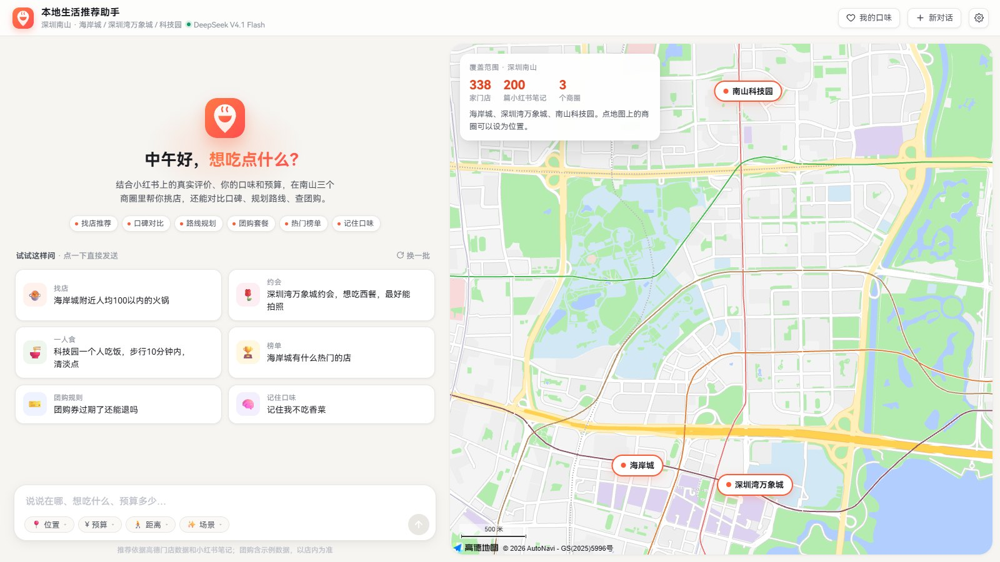
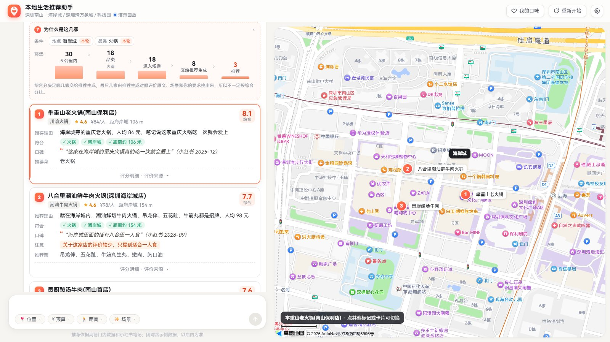
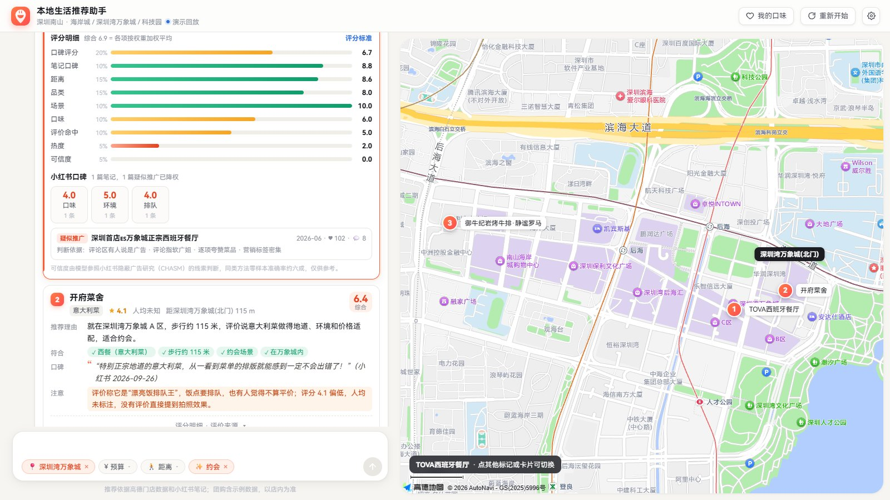
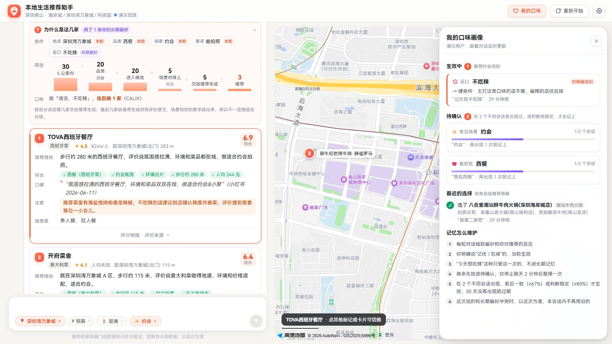
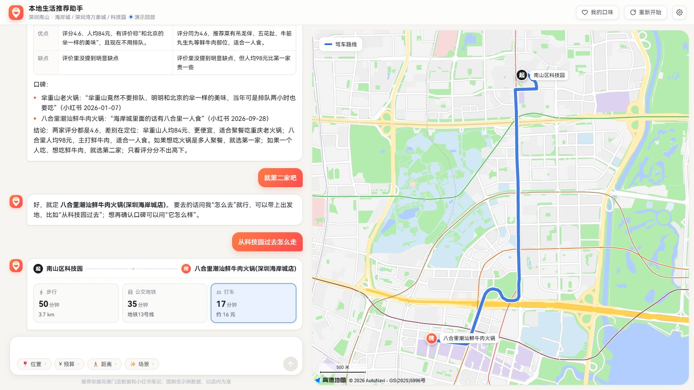
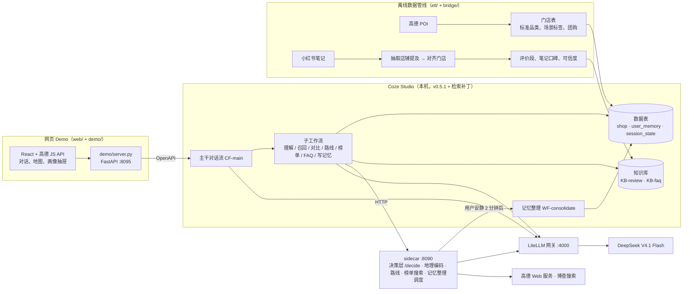

<div align="center">


# COZEAT · 本地生活推荐 Agent

在本机开源 [Coze Studio](https://github.com/coze-dev/coze-studio) 上搭的餐饮推荐 Agent。
用户用一句话说想吃什么，它结合小红书上的真实评价、用户的长期口味和预算，在深圳南山三个商圈里挑店，
能对比口碑、规划路线、查团购，并且说明每家店为什么被选中。

</div>



> 字节跳动实习项目，非商用。目前覆盖深圳南山的海岸城、深圳湾万象城、南山科技园三个商圈。

## 功能

| 能力 | 用户这样说 | Agent 做什么 |
|---|---|---|
| 找店推荐 | "海岸城附近人均 100 以内的火锅，不吃辣" | 理解地点、品类、预算、距离、口味、场景和对店的要求，召回、打分、挑 3 家，每家给推荐理由、符合项、小红书原话、注意事项 |
| 条件追问 | "饿了" | 缺地点和品类时问一句，给出可点选的选项；同一个缺口只问一次，"你看着办"就按默认推荐 |
| 对比评价 | "第一家和第二家哪个好" | 认出指的是哪几家，按人均、评分、推荐菜、适合场景、优缺点出对比表和结论 |
| 路线规划 | "从科技园过去怎么走" | 步行、公交地铁、打车三种方式的时间和费用，地图上画出路线 |
| 团购套餐 | "第一家有团购吗" | 列出这家店的团购，写明是哪篇笔记、什么时候提到的 |
| 热门榜单 | "海岸城有什么热门的店" | 实时搜网页榜单，和本地笔记热度合起来回答，注明来源 |
| 平台规则 | "团购券过期了还能退吗" | 检索平台规则和助手说明的 FAQ 后回答 |
| 长期记忆 | "记住我不吃辣" | 明说的当轮生效；对话里流露的偏好先进待确认，在多个会话出现后才记上；之后找店自动带上 |
| 推荐可解释 | — | 每次推荐附"为什么是这几家"：每个条件的来源（本轮说的 / 长期偏好 / 默认假设）、筛选漏斗、口味偏好让哪些店加分或往后排 |
| 多维评分 | — | 每家店 10 个维度各 0–10 分（口碑、笔记口碑、距离、预算、品类、场景、口味、评价命中、热度、可信度），加权得综合分，附评分标准 |
| 评价可信度 | — | 参考的小红书笔记逐篇判断是不是推广或软广，标真实体验 / 存疑 / 疑似推广 / 明确合作，疑似推广的笔记在口碑分里降权 |

<table>
<tr>
<td width="50%"><br/><sub>找店：条件来源、筛选漏斗、每家店的综合分</sub></td>
<td width="50%"><br/><sub>评分明细、小红书口碑、参考笔记的可信度</sub></td>
</tr>
<tr>
<td width="50%"><br/><sub>"我的口味"：生效偏好、待确认、推荐策略、维护规则</sub></td>
<td width="50%"><br/><sub>路线：三种出行方式，地图画出路线</sub></td>
</tr>
</table>

## 架构



一轮对话在主干里这样走：

```
读会话状态、读画像 → 理解（决策层判意图和反馈 ‖ 记忆抽取 ‖ 槽位提取）→ 分流
  找店：缺条件就追问 ｜ 召回 → 推荐生成 → 格式化校验
  对比 / 路线 / 问某家团购：认店 → 对应子工作流
  榜单、FAQ、偏好管理、意图澄清、确认选择
→ 汇总回答 → 写会话状态和长期记忆 → 通知 sidecar 稍后整理
```

找店的召回链路：

```
槽位（地点、品类、预算区间、距离、口味、场景、对店的要求）
→ 地理编码 ‖ 按"品类 + 要求 + 场景"在全部评价里跨店检索
→ SQL 召回 5 公里内 30 家（品类按两级标准品类展开，点名的菜单独命中）
→ 逐级放宽（都满足 → 放宽距离 → 放宽预算 → 放宽品类）
→ 10 维打分取 12 家 → 每家取评价证据 → 按场景过滤，留 8 家
→ 推荐生成挑 3 家、引用原话 → 格式化（原话必须在证据里找得到）
```

## 几处设计

- **工作流用代码生成。** 主干和子工作流的画布由 `bridge/` 下的 Python 脚本拼出来，经 Coze 内部接口保存、调试、发布；代码节点源码和 SQL 集中在 `bridge/flow_code.py`。改流程是改代码再重建，版本可追溯，子工作流发布版由主干锁定版本号。
- **决策层和 LLM 节点分开。** 意图（D2）、对上轮推荐的反馈（D1）、偏好是否长期稳定（D4）由 sidecar 的 `/decide` 统一判断，接口格式兼容 Jev 决策模型，现在后端是普通 LLM；超时时退回 Coze 自带的意图节点。
- **长期记忆。** 每轮抽取偏好和反馈，按"本轮 > 本会话 > 长期"处理改口；长期偏好要在 2 个不同会话出现且前后一致，或判断很稳定，才生效；整理时按用户选店的反馈改写一段推荐策略（参照 SAGER 的每用户策略文本）。
- **品类和区间。** 高德品类太粗（42% 的门店只写"中餐厅""餐饮相关场所"），自建两级标准品类表（13 大类、54 细类），门店打标和查询展开共用一份；预算、距离按区间理解（"一两百"是 100–200，"步行十分钟"是 800 米）。
- **检索补丁。** 读 Coze Studio 源码发现知识库检索有三个实现问题（混合检索 RRF 取最大值不求和、top_k 没下传、结果不按相关度排序），打了补丁，同一份数据上找店 hit@5 从 65% 到 96%，见 [infra/coze-patch](infra/coze-patch/README.md)。

## 数据

| 数据 | 来源 | 进入系统的方式 |
|---|---|---|
| 门店（评分、人均、营业时间、推荐菜、坐标） | 高德 POI | 按商圈周边抓取，打标准品类和场景标签后写入门店表 |
| 评价 | 小红书笔记 | 抽取店铺提及 → 对齐到门店 → 按"一条提及一段"写入评价知识库 |
| 笔记可信度、笔记口碑 | 由评价派生（`etl/note_quality.py`） | 逐篇判断是否推广，按口味、环境、服务、性价比、排队打分，按店汇总后进入评分 |
| 团购 | 笔记提到的团购 | 从笔记里抽取，写明来源和日期 |
| 平台规则 FAQ | 抖音生活服务规则中心 | 整理成问答写入 FAQ 知识库，出处在 `data/faq/SOURCES.md` |
| 网页榜单 | 博查搜索 | 对话时实时查，按天缓存 |

现在门店和评价是按批跑管线更新的（`etl/` → `bridge/load_*`），每一步可以单独重跑，对齐结果有审计关卡。后续方向是改成实时抓取：按商圈和关键词持续发现新笔记，增量抽取、对齐、判断可信度后写入知识库，门店信息定期从高德刷新。

仓库里只有处理后的数据（`data/processed/`、`data/faq/`），抓取的原文、图片和浏览器登录态不入库。

## 评测

| 评测 | 内容 | 结果 |
|---|---|---|
| E1 理解 | 179 条句子的意图和槽位（手写难例 + 生成） | 槽位 micro F1 0.995，意图 178/179 |
| E2 检索 | 5 种切分策略的知识库召回对照；检索补丁前后对照 | 补丁后找店 hit@1 15% → 89%，hit@5 65% → 96% |
| 跨店召回 | 57 条带要求的找店句，答案店能否进入推荐候选 | 开跨店检索 51/57，关掉 35/57 |
| E3 长期记忆 | 16 段多轮脚本（记住、忘掉、改口、只管一次、跨会话） | 终态 16/16 |
| E5 端到端 | DeepSeek 扮用户，12 个找店任务，部分条件只存在于长期记忆 | 12/12，单轮延迟中位 24 秒 |

测试集规模小，部分用例由模型生成，数字偏乐观。脚本在 `eval/`，每次的报告在 `eval/reports/`。

## 运行

需要：Docker、本机部署的 Coze Studio v0.5.1（建议打上 `infra/coze-patch` 的检索补丁）、Python 3.11+、Node 22，以及 DeepSeek、高德、博查的 key。

```bash
# 1. 配置：复制 infra/.env.example 为 infra/.env 并填写
# 2. 先起 LLM 网关
docker compose -f infra/docker-compose.yml --env-file infra/.env up -d --build litellm

# 3. 在 Coze Studio 里注册模型，建表和知识库（第一次运行会注册本地账号，存在 local-account.txt；
#    建表时生成 lifeagent_ids.json，记录所有表、知识库、工作流的 id）
python -I -X utf8 bridge/register_model.py add deepseek-flash "DeepSeek V4.1 Flash（经 LiteLLM 网关）"
python -I -X utf8 bridge/build_storage.py
python -I -X utf8 bridge/build_agent.py create

# 4. 起 sidecar（它挂载 lifeagent_ids.json，要在上一步之后）
docker compose -f infra/docker-compose.yml --env-file infra/.env up -d --build sidecar

# 5. 写入数据
python -I -X utf8 bridge/load_shops.py
python -I -X utf8 bridge/load_kb.py --rebuild
python -I -X utf8 bridge/load_faq.py

# 6. 建并发布工作流（子工作流 → 记忆整理 → 主干），再把智能体切到对话流模式
python -I -X utf8 bridge/build_subflows.py release
python -I -X utf8 bridge/build_memory.py release v0.0.1
python -I -X utf8 bridge/build_cf_main.py release v0.0.1
python -I -X utf8 bridge/build_agent.py chatflow

# 7. 命令行试一句（第一次会创建 COZE_PAT）
python -I -X utf8 bridge/chat_api.py "海岸城附近人均100以内的火锅" demo-user conv-1

# 8. 网页 Demo
cd web && npm install && npm run build && cd ..
python -I -X utf8 demo/server.py      # http://localhost:8095
```

`register_model.py add` 会打印模型的 `model_type`，填到 `bridge/flow_code.py` 的 `MODEL_TYPE`（智能体和所有节点都从这里取）。网页 Demo 默认是演示回放（按 → 键逐句放录好的对话），`?mode=live` 是实时对话；录制和自动出视频见 [demo/README.md](demo/README.md)。

## 目录

```
bridge/    Coze 接口封装；主干、子工作流、记忆整理的画布生成和发布；数据写入；调试工具
           flow_code.py 是所有代码节点的源码和 SQL
sidecar/   FastAPI 服务：决策层、地理编码、路线、榜单搜索、记忆整理调度
prompts/   各 LLM 节点的提示词（带版本号，旧版留作对照）
etl/       门店抓取、小红书抽取、提及对齐、标准品类、团购、笔记可信度
common/    LLM 调用、环境变量、标准品类表
web/       网页前端（Vite + React + TypeScript + 高德 JS API 2.0）
demo/      Demo 后端、演示脚本录制、自动出视频
eval/      E1–E5 评测脚本、用例、报告
infra/     docker compose、LiteLLM 配置、Coze Studio 检索补丁
canvases/  生成的画布 JSON（令牌已替换成占位符）
research/  前期调研：平台能力、数据渠道、编排方式、持续学习、同类开源项目
data/      处理后的门店、提及、FAQ 数据
```

## 文档

- [DESIGN.md](DESIGN.md)：架构、表结构、知识库、工作流、决策层、记忆、评测和里程碑的设计
- [HANDOVER.md](HANDOVER.md)：逐日进度和交接
- [docs/DEV_NOTES.md](docs/DEV_NOTES.md)：维护笔记（常用命令、踩过的坑、已知缺口）
- [bridge/COZE_API_NOTES.md](bridge/COZE_API_NOTES.md)：Coze Studio 内部接口和运行时行为
- [research/](research/)：调研报告
